# AnyShift

Hold a key on any keyboard (e.g. a Wooting) to activate Logitech G HUB **G-Shift** on a Logitech mouse.

It sends `SET /input/gshift {on, source: "HOST"}` to the G HUB agent's local websocket API (`ws://127.0.0.1:9010`), the same undocumented API the G HUB UI uses. A G HUB update may break it.

- Trigger key: **F13** (map it in Wootility). Change `VK` in `src/main.rs` for another key.
- Build: `cargo build --release`, then put `target/release/anyshift.exe` in `shell:startup`.
- The mouse's G-Shift layer is whatever you assign in G HUB for the active profile.
